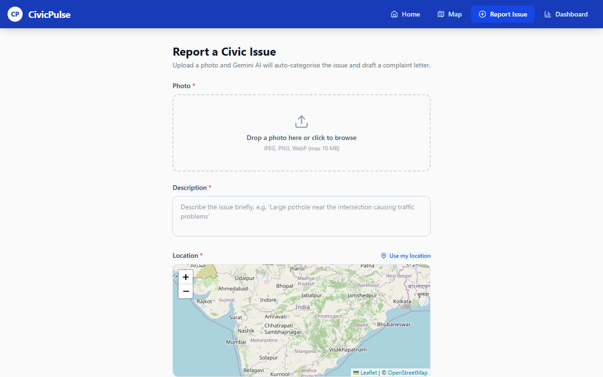

# CivicPulse

**Snap a photo of a pothole, get a categorised report and a ready-to-send complaint letter.**

[](https://github.com/smadhu6364-beep/civicpulse/actions/workflows/ci.yml)


[](LICENSE)



Potholes, broken streetlights, illegal dumping: the small stuff that makes a neighbourhood feel neglected rarely gets reported, because reporting it is a hassle. CivicPulse turns a single photo into a categorised, severity-scored, ready-to-send complaint letter, then drops a pin on a live community map so everyone can see what has been flagged and back it with an upvote.

## How It Works

1. **Report.** A resident uploads a photo of the issue, pins its location on the map, and adds a short description.
2. **Analyse.** Gemini Vision reads the photo alongside the description to classify the issue and estimate its severity.
3. **Route.** CivicPulse matches the category to the correct municipal department, for example potholes to Roads and Infrastructure, or leaks to Water and Sewerage.
4. **Escalate.** A formal complaint letter is drafted automatically, citing the issue, its impact, and a request for action within a set timeline.
5. **Track.** The report appears on the live map with its photo attached, where other residents can verify it and add their upvote.

## Features

- **Snap-and-report.** Upload a photo, drop a pin on the map, and add a short description; that is the entire reporting flow.
- **Gemini Vision analysis.** Automatic categorisation across eleven issue types, severity scoring (low, medium, high), and identification of the responsible municipal department.
- **Photo storage.** Reported images are persisted to Firebase Storage and displayed on the issue detail page and in the quick-view modal.
- **AI-drafted complaint letters.** A formal, ready-to-send letter addressed to the correct authority, generated for every report.
- **Interactive map.** Every issue is plotted with Leaflet.js using colour-coded severity pins.
- **Community verification.** Residents can upvote existing reports to confirm an issue is real and ongoing.
- **Live dashboard.** Total issues, resolution rate, category breakdown, and severity distribution at a glance.

## Tech Stack

| Layer | Technology |
|---|---|
| Frontend | React 19, Vite 8, Tailwind CSS 4, React Router 7, Leaflet (react-leaflet 5) |
| Backend | Python, FastAPI |
| AI | Google Gemini via the `google-genai` SDK (default model `gemini-3.8-flash`, configurable) |
| Database | Firebase Firestore |
| Storage | Firebase Storage |
| Deployment | Google Cloud Run (+ Docker) |

## Quick Start

### Prerequisites

- Python 3.11+
- Node.js 20+
- A [Google Gemini API key](https://aistudio.google.com/app/apikey)
- A Firebase project with Firestore enabled

### 1. Firebase Setup

1. Go to [Firebase Console](https://console.firebase.google.com) and create a new project
2. Enable **Firestore Database** (start in test mode for development)
3. Optionally enable **Storage** if you want uploaded photos to persist
4. Go to Project Settings, then Service Accounts, then generate a new private key
5. Save the downloaded JSON as `backend/serviceAccount.json`

### 2. Backend

```bash
cd backend
cp .env.example .env
# Edit .env with your keys

pip install -r requirements.txt
uvicorn main:app --reload --port 8000
```

The API will be available at `http://localhost:8000`.
Interactive docs: `http://localhost:8000/docs`

### Tests

The backend tests stub out Gemini and Firestore, so they need no keys:

```bash
cd backend
pip install -r requirements-dev.txt
pytest
```

### 3. Frontend

```bash
cd frontend
cp .env.example .env
# VITE_API_URL defaults to /api (proxied by Vite to localhost:8000)

npm install
npm run dev
```

Open `http://localhost:5173`.

### 4. Docker Compose (full stack)

```bash
cp .env.example .env
# Edit .env with GEMINI_API_KEY, FIREBASE_PROJECT_ID, FIREBASE_STORAGE_BUCKET
# Place backend/serviceAccount.json

docker compose up --build
```

Frontend: `http://localhost`. Backend: `http://localhost:8000`.

## Environment Variables

### Backend (`backend/.env`)

| Variable | Description |
|---|---|
| `GEMINI_API_KEY` | Google Gemini API key |
| `GEMINI_MODEL` | Optional. Gemini model ID (default: `gemini-3.8-flash`) |
| `FIREBASE_PROJECT_ID` | Firebase project ID |
| `FIREBASE_SERVICE_ACCOUNT_PATH` | Path to service account JSON (default: `./serviceAccount.json`) |
| `FIREBASE_SERVICE_ACCOUNT_JSON` | Service account as JSON string (for Cloud Run) |
| `FIREBASE_STORAGE_BUCKET` | Firebase Storage bucket (optional, enables photo persistence) |
| `ALLOWED_ORIGINS` | Comma-separated CORS origins |

### Frontend (`frontend/.env`)

| Variable | Description |
|---|---|
| `VITE_API_URL` | Backend API base URL (default: `/api`, proxied in dev) |

## Deploying to Google Cloud Run

### Backend

```bash
cd backend
gcloud builds submit --tag gcr.io/YOUR_PROJECT/civicpulse-backend
gcloud run deploy civicpulse-backend \
  --image gcr.io/YOUR_PROJECT/civicpulse-backend \
  --platform managed \
  --region us-central1 \
  --allow-unauthenticated \
  --set-env-vars GEMINI_API_KEY=...,FIREBASE_PROJECT_ID=...,FIREBASE_SERVICE_ACCOUNT_JSON='...'
```

Use `FIREBASE_SERVICE_ACCOUNT_JSON` (the full JSON as a string) instead of a file path on Cloud Run. Store it in Secret Manager for production.

### Frontend

```bash
cd frontend
# Set VITE_API_URL to your Cloud Run backend URL at build time
VITE_API_URL=https://civicpulse-backend-xxx-uc.a.run.app/api npm run build

gcloud builds submit --tag gcr.io/YOUR_PROJECT/civicpulse-frontend \
  --build-arg VITE_API_URL=https://civicpulse-backend-xxx-uc.a.run.app/api
gcloud run deploy civicpulse-frontend \
  --image gcr.io/YOUR_PROJECT/civicpulse-frontend \
  --platform managed \
  --region us-central1 \
  --allow-unauthenticated
```

## API Reference

| Method | Endpoint | Description |
|---|---|---|
| `POST` | `/api/issues/` | Report a new issue (multipart form); returns the AI analysis and hosted photo URL |
| `GET` | `/api/issues/` | List all issues |
| `GET` | `/api/issues/{id}` | Get a single issue |
| `POST` | `/api/issues/{id}/upvote` | Upvote / verify an issue |
| `GET` | `/api/issues/dashboard` | Dashboard statistics |
| `GET` | `/health` | Health check |

### Report Issue: Form Fields

| Field | Type | Required |
|---|---|---|
| `image` | file | Yes |
| `description` | string | Yes |
| `lat` | float | Yes |
| `lng` | float | Yes |
| `address` | string | No |
| `reporter_name` | string | No |
| `reporter_email` | string | No |

## Project Structure

```
civicpulse/
├── backend/
│   ├── main.py                    # FastAPI app entry point
│   ├── models.py                  # Pydantic models
│   ├── routers/
│   │   └── issues.py              # Issue endpoints
│   ├── services/
│   │   ├── gemini_service.py      # Gemini Vision analysis + letter generation
│   │   └── firestore_service.py   # Firestore CRUD + Firebase Storage uploads
│   ├── tests/                     # API tests (no keys needed)
│   ├── requirements.txt
│   ├── Dockerfile
│   └── .env.example
├── frontend/
│   ├── src/
│   │   ├── App.jsx                # Router
│   │   ├── components/
│   │   │   ├── Navbar.jsx
│   │   │   ├── Home.jsx           # Landing page
│   │   │   ├── MapView.jsx        # Leaflet map with severity pins
│   │   │   ├── IssueForm.jsx      # Report form with map picker
│   │   │   ├── IssueDetail.jsx    # Full issue detail page
│   │   │   ├── IssueModal.jsx     # Quick-view issue modal
│   │   │   └── Dashboard.jsx      # Stats + recent issues table
│   │   └── services/
│   │       └── api.js             # Axios API client
│   ├── Dockerfile
│   ├── nginx.conf
│   └── .env.example
├── docker-compose.yml
└── README.md
```

## Status and limitations

- There is no hosted demo: running it needs your own Gemini API key and Firebase project.
- If Gemini is unavailable or the key is missing, the backend still saves the report with category "other", medium severity and a template letter.
- No user accounts or moderation; anyone can report and upvote.
- CI runs the backend tests and the frontend build. It does not call Gemini or Firebase.

## Licence

MIT, see [LICENSE](LICENSE).
